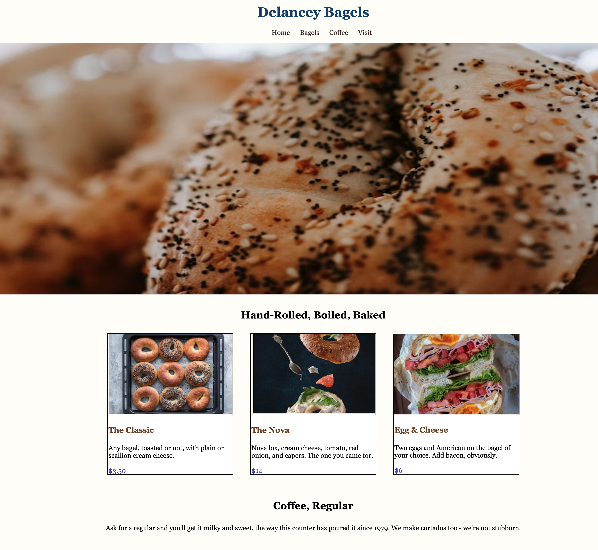

# NYC Bagels

Website for a New York City bagel shop featuring the menu, business hour and location. Built with HTML and CSS.

## Demo

Live: [Live Demo](https://bagelatnyc.netlify.app/)



## About the Project

I built this page to practice structuring and styling a content-focused web page using only HTML and CSS.

## Features

- Clean, easy-to-read layout
- Photos of bagels 
- Responsive design that works on desktop and mobile


## Built With

- HTML5
- CSS3

## Getting Started

1. Clone the repo
   ```bash
   git clone https://github.com/sabrinalindev/nyc-bagels.git
   cd nyc-bagels
   ```
2. Open `index.html` in your browser

No build step or dependencies are required.

## Project Structure

```
nyc-bagels/
├── index.html      # Main page
├── css/            # Stylesheets
└── img/            # Images
```

## What I Learned

- How to structure a web page with semantic HTML
- How to style a page and build a responsive layout with CSS
- How to organize files in a small web project

